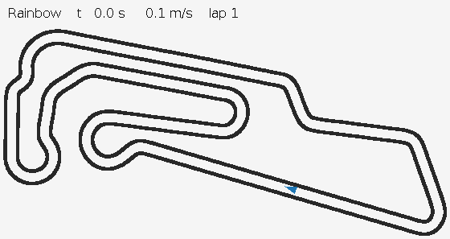

# F1TENTH Reinforcement Learning

Reinforcement learning agents for autonomous racing in the F1TENTH simulator.



Rainbow on Oschersleben, 2 laps in 73.1 s (6x speed).

## Installation

Ubuntu or WSL with Anaconda.

```bash
sudo apt install -y libglu1-mesa

conda create -n f1tenth python=3.8 -y
conda activate f1tenth
pip install "setuptools<58.0.0"
python -m pip install "pip==22.0.3"
pip install torch torchvision torchaudio --index-url https://download.pytorch.org/whl/cpu
pip install matplotlib
```

Clone this repository, then clone the simulator into its root:

```bash
git clone https://gitlab.com/acrome-colab/riders-poc/f1tenth-riders-quickstart --config core.autocrlf=input
pip install -e f1tenth-riders-quickstart/gym
```

## Training

```bash
python train.py --agent <agent>
```

| `--agent` | Algorithm | Action space |
|---|---|---|
| `dqn` | DQN (Double + Dueling) | discrete |
| `c51` | C51 | discrete |
| `qrdqn` | QR-DQN | discrete |
| `rainbow` | Rainbow | discrete |
| `reinforce` | REINFORCE | discrete / continuous |
| `a2c` | A2C | discrete / continuous |
| `ppo` | PPO | discrete / continuous |
| `ddpg` | DDPG | continuous |
| `td3` | TD3 | continuous |
| `sac` | SAC | continuous |

```bash
python train.py --agent rainbow
python train.py --agent td3 --name td3_f4 --set agent.train_freq=4
python train.py --agent ppo --set env.action_type=continuous
python train.py --agent sac --set env.map=SOCHI eval.map=Oschersleben
python train.py --resume runs/td3_f4 --set train.total_steps=4000000
```

| Option | Description |
|---|---|
| `--set KEY=VALUE ...` | Override values from `configs/base.yaml` and `configs/agents/<agent>.yaml` |
| `--name` | Run name (default `<agent>_<timestamp>`) |
| `--resume RUN_DIR` | Continue a run from its `checkpoint.pt` |
| `--render` | Show the training car |

Ctrl+C or `kill` stops a run after saving. Results are written to `runs/<name>/`:

| File | Content |
|---|---|
| `config.yaml` | Full configuration of the run |
| `progress.csv` | Per-episode training log |
| `eval.csv` | Periodic evaluation log |
| `best.pt` | Best evaluated model (finish rate, then lap time, then return) |
| `last.pt` | Latest model |
| `checkpoint.pt` | Full training state for `--resume` |

## Evaluation

```bash
python evaluate.py runs/<name>
python evaluate.py runs/<name> --checkpoint last.pt --set env.map=SOCHI
python evaluate.py runs/<name> --no-render
python plot.py runs/<name> runs/<other> --show
python tools/record_gif.py runs/<name> --out docs/<name>.gif
```

The viewer draws every `render_every` steps (default 10). Use `--set render_every=1` for real-time playback.

## Configuration

`configs/base.yaml` holds the environment and training settings, `configs/agents/<agent>.yaml` the algorithm hyperparameters.

| Key | Description |
|---|---|
| `env.map` | `Oschersleben`, `SOCHI`, `SOCHI_OBS` |
| `env.action_type` | `discrete` or `continuous` |
| `env.steering_angles`, `env.speeds` | Discrete actions (steering rad x speed m/s) |
| `env.max_steering`, `env.speed_range` | Continuous action range |
| `env.action_repeat` | Simulator steps per action (1 step = 0.01 s) |
| `env.frame_stack` | Number of stacked observations |
| `env.time_limit` | Episode time limit in seconds |
| `train.total_steps` | Training steps |
| `train.random_start` | Start training episodes at random track positions |
| `eval.interval`, `eval.map`, `eval.render` | Evaluation settings |
| `threads` | PyTorch CPU threads |

## Observation

Add a function to `f1tenth_rl/observations.py` and select it with `observation.name`. It receives the simulator observation and returns a 1-D array; the network input size and frame stacking follow automatically.

```python
@register
def my_observation(obs, num_beams=108, max_range=10.0):
    ...
    return features
```

```bash
python train.py --agent ppo --set observation.name=my_observation observation.num_beams=54
```

| Built-in | Content | Size |
|---|---|---|
| `lidar` | LiDAR downsampled to `num_beams` (min per sector) / `max_range`, speed / `max_speed` | 109 |
| `lidar_control` (default) | `lidar` + yaw rate, previous steering and speed commands | 112 |

| `obs` key | Content |
|---|---|
| `scans` | `[array(1080)]` LiDAR ranges over 270 degrees, from the right |
| `poses_x`, `poses_y`, `poses_theta` | Position (m), heading (rad) |
| `linear_vels_x`, `ang_vels_z` | Speed (m/s), yaw rate (rad/s) |
| `steer_cmd`, `speed_cmd` | Steering (rad) and speed (m/s) commands of the previous step |
| `collisions`, `lap_counts`, `lap_times` | Simulator flags |

Values other than `scans` are length-1 arrays, e.g. `obs['linear_vels_x'][0]`.

## Reward

Add a function to `f1tenth_rl/rewards.py` and select it with `reward.name`.

```python
@register
def my_reward(obs, prev_obs, info, collision_penalty=10.0):
    ...
    return reward
```

```bash
python train.py --agent sac --set reward.name=my_reward reward.collision_penalty=20
```

| Built-in | Reward per step |
|---|---|
| `progress` (default) | track progress (m) - `steer_penalty` * \|Δsteer\| / `max_steering` - `speed_penalty` * \|Δspeed\| / `max_speed` - `collision_penalty` on collision + `lap_bonus` per lap |
| `speed` | speed * dt - `collision_penalty` on collision + `lap_bonus` per lap |

| `info` key | Content |
|---|---|
| `progress` | Distance advanced along the track this step (negative when driving backwards) |
| `distance` | Total progress in the episode |
| `collision`, `finished`, `truncated` | Episode end flags |
| `lap_count`, `new_laps`, `lap_time`, `dt` | Laps, laps completed this step, elapsed time (s), step duration (s) |

Values in `observation.*` and `reward.*` that the selected function does not take are ignored.

## Tracks

`tracks/<map>.csv` stores poses `(x, y, theta)` along a reference lap. They are used for random training starts, track progress and lap counting. To add a map, put its start pose in `env.start_poses` and run:

```bash
python tools/record_track.py SILVERSTONE
```

## Credits

- [f1tenth-riders-quickstart](https://gitlab.com/acrome-colab/riders-poc/f1tenth-riders-quickstart) (Acrome)
- [f1tenth_gym](https://github.com/f1tenth/f1tenth_gym)
